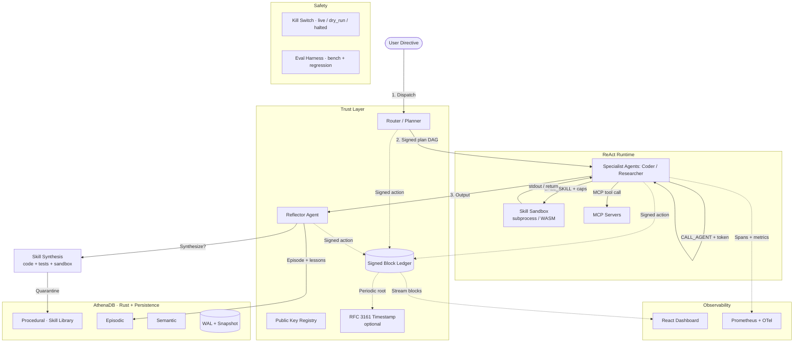

# Athena Swarm Architecture

Athena is a self-improving multi-agent swarm engineered around three differentiating pillars: **cryptographic agent identity**, **sandboxed skill execution**, and **curated self-improvement**. The Rust vector core, tri-partite memory, ReAct runtime, and React UI are the substrate that makes these pillars usable.

---

## System Overview

---

## 0. Foundational Invariants

Properties baked into the data model and runtime from the first commit — cheap now, rearchitect to retrofit:

- **Embedding-model version tag** on every vector — switching embedders never silently corrupts similarity math.
- **Schema version** on every memory record — forward-migratable as schemas evolve.
- **Namespace** on every entity (default `"default"`) — multi-tenancy is a field, not a migration.
- **Durable, resumable execution** — the ReAct loop checkpoints after each step; crashed tasks resume mid-flight.
- **Reproducibility envelope** per episode — model id, temperature, seed, prompt hash, retrieved-memory hash — so a self-improving regression is debuggable.
- **Key rotation with validity windows** — historical blocks verify against the key valid at signing time.
- **Cost/budget guard** and **HITL approval gate** as first-class loop primitives, not afterthoughts.
- **Content trust tagging** — retrieved memory and tool outputs are `untrusted` until proven otherwise.

---

## 1. Cryptographic Identity & Ledger

The trust foundation. Every agent is a keypair; every action is a signed block.

- **Ed25519 keypair per agent.** Public key, base58-encoded, *is* the `agent_id`. Private key persisted to disk with `0600` perms. No salts, no hash-of-config — the key itself is identity.
- **Key rotation.** An agent can rotate its keypair while keeping a stable `agent_id`; a signed rotation record links old → new key, and the registry tracks each key's validity window so blocks always verify against the key valid when signed.
- **Secrets broker.** Skills declare which named secrets they need; the broker injects them as scoped env vars at sandbox launch and scrubs their values from all captured output. Skill code never sees a raw key.
- **Capability tokens.** Signed grants between agents: `{issuer, subject, capability, expires_at, signature}`. Required for every cross-agent handoff; verified before the receiving agent accepts work.
- **Signed block ledger.** Each block: `{index, timestamp, agent_id, action_type, payload, prev_hash, signature}`. `signature` covers the entire block content; `prev_hash` chains blocks. Verifying the chain checks both hash linkage *and* each signature against the registry.
- **Public Key Registry.** Maps agent_ids to public keys; new keys auto-registered on first observed action and recorded as a registration block.
- **Optional external anchoring.** Every N blocks the Merkle root is posted to an RFC 3161 timestamp service. This makes the chain tamper-proof against the platform operator, not just against external attackers.

This is the upgrade from a tamper-evident log to a real trust system: provable provenance, capability-based authorization, and reputation that can be built on top of signed action histories.

---

## 2. Skill Sandbox

LLM-generated code never executes in the agent process.

- **Phase 1 implementation:** `subprocess` with `resource.setrlimit` (CPU, memory, FD count), no-network namespacing, signal-based time limits, captured `stdout` / `stderr` / return value / exit code / peak RSS.
- **Phase 2 migration target:** `wasmtime` + Pyodide. WASM has no syscalls by default; capabilities are explicit grants. The runner interface is designed so this swap is a one-file change.
- **Capability model.** Every skill declares `{net, fs_read, fs_write, time_limit_s, mem_mb}` at synthesis time. Declared caps are enforced at the sandbox boundary and statically checked against the skill's AST (imports outside declared caps reject the skill).

---

## 3. AthenaDB — Vector Core with Persistence

A custom Rust vector database optimized for the swarm's memory access patterns.

> **AthenaDB is a separate project**, developed and released independently
> (sibling repo `../athenadb`). Athena consumes it as a dependency — the native
> Python module is built into the venv via `maturin`. The design below is
> summarized here for context; the DB's own repo is the source of truth.

- **`core.rs`** — `VectorStore` with `rayon`-parallel cosine similarity, SIMD-friendly f32 layout. Benchmarked to ≥ 1M vectors at 768d, top-10 < 50 ms on M-series Mac.
- **`wal.rs` + `snapshot.rs`** — append-only WAL written before every mutation; periodic full snapshots; WAL compaction after snapshot; crash-consistent recovery on boot.
- **`lib.rs`** — PyO3 bindings expose `add`, `query`, `delete` and the compatibility shim used by `MemoryManager`.
- **`bin/server.rs`** — Axum server scaffolded but routes return `501` until Phase 5 commits to the multi-service deployment.

In-RAM access for the local swarm, with disk durability so a restart doesn't lobotomize the brain.

---

## 4. Tri-Partite Memory + Retrieval Policy

Storage is one logical AthenaDB partitioned into three namespaces. The interesting part is the policy that decides *what to load*.

- **Semantic.** Facts, configs, persistent context. Retrieval favors similarity.
- **Episodic.** Task traces (`goal`, `plan`, `steps`, `outcome`, `cost`, `signatures`). Retrieval favors recency: `score = similarity × exp(-age / half_life)`.
- **Procedural (Skill Library).** Synthesized skills with versions, declared caps, success rate, parent_skill_id. Retrieval favors success_rate.
- **Token-budgeted retrieval.** Caller specifies `max_tokens`; retriever packs as many relevant memories as fit.
- **Optional reranker.** Cross-encoder rerank for top-N before final cut.
- **Dedup, compression, forgetting.** Insertions with cosine > 0.95 to an existing entry merge metadata rather than duplicate. Old episodes auto-summarize into "lessons" entries. Persistently low-relevance entries archive to cold storage.

---

## 5. ReAct Runtime & The Swarm

Agents reason iteratively (`think → act → observe`), but with a planner above and a reflector below.

- **Router / Planner.** Decomposes a directive into a DAG of subtasks. Emits a signed plan.
- **Specialists** (`coder`, `researcher`, ...). Differentiated by system prompt and which memory partitions they query. Execute their slice of the DAG.
- **Reflector.** Reads the full trace. Empowered to *reject and retry* (not just log). Decides whether the task surfaces a missing skill — if so, triggers synthesis.
- **Executor.** Drives sandboxed skill execution and MCP tool calls.

Three runtime protocols, all logged as signed ledger blocks:

- `CALL_SKILL { skill_id, args }` — pull from procedural memory, sandbox-execute with declared caps.
- `CALL_AGENT { agent_id, capability_token, payload }` — receiver verifies token, then accepts.
- `MCP_TOOL { server, tool, args }` — call any MCP-registered tool. First-class to avoid reinventing every connector.

---

## 6. Skill Synthesis & Curation

The piece most agent frameworks skip. Without it, the skill library accumulates junk within a week.

Pipeline when the Reflector decides a new skill is warranted:

1. **Generate** code + declared capabilities.
2. **Generate tests** — 3–5 unit tests synthesized separately against the original task.
3. **Sandbox-run tests** with the declared caps.
4. **Quarantine** — passing skills enter procedural memory with `status: quarantined`.
5. **Promote** after K successful real uses (default K=3) to `status: promoted`.
6. **Deprecate** if failure rate exceeds threshold; chain via `parent_skill_id` so improvements are versioned.

Dedup before insert: embed `name + docstring`; if cosine > 0.9 to an existing skill, store as a new *version* rather than a sibling.

---

## 7. Evaluation Harness

Self-improvement without measurement is drift.

- **Benchmark suite.** `bench/<task>/{task.yaml, expected.json}` covering coding, retrieval, multi-step reasoning.
- **Harness.** Runs the suite, scores per-task, aggregates success rate, mean tokens, mean latency, mean cost.
- **Regression mode.** When a new skill is promoted, re-run benchmarks that previously failed *without* this skill. Records lift.
- **Reports.** `eval/runs/<timestamp>/report.html` with deltas vs. last run.
- **CI hook.** Any PR touching `src/agents/` or `src/skills/` runs the harness before merge.

---

## 8. Observability & Safety

A platform you can debug under load and stop in an emergency.

- **Prometheus metrics:** `swarm_tasks_total{outcome}`, `swarm_task_duration_seconds`, `skill_invocations_total`, `llm_tokens_total`, `llm_cost_usd_total`.
- **OpenTelemetry traces:** root span per task, one span per agent step, one per skill invocation. Attributes include `agent_id` and `block_hash`.
- **Structured JSON logs** with `task_id`, `agent_id`, `block_index`.
- **Kill switch.** `SAFETY_MODE = live | dry_run | halted`. `halted` short-circuits all execution. `dry_run` runs the LLM but skips the sandbox — essential for debugging self-modification.

---

## 9. UI — Observability Surface

React + Vite + Tailwind dark monospace dashboard, FastAPI + WebSockets backend.

- **Task Console** — dispatch directives, render the plan DAG live.
- **Swarm Feed** — collapsible per-agent traces with signature + ledger hash on each card.
- **Chain Auditor** — visualize blocks, verify signatures, surface tampering.
- **Skill Library Browser** — version, status, success rate, recent usage; filter by capability.
- **Eval Dashboard** — bench score trend, cost-per-task trend, regression alerts.

---

## Out of Scope (for now)

- Multi-tenant isolation, distributed AthenaDB replication.
- Custom model fine-tuning — Athena uses off-the-shelf Claude.
- Computer-use / browser-control skills (revisit after Phase 4).
- Blockchain consensus protocols — signed actions + optional anchoring are sufficient for a single-org swarm.
