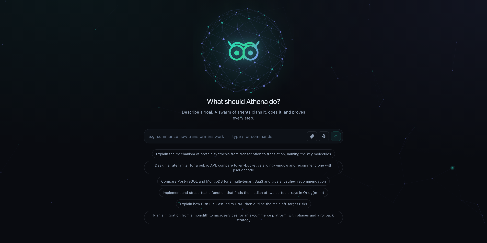
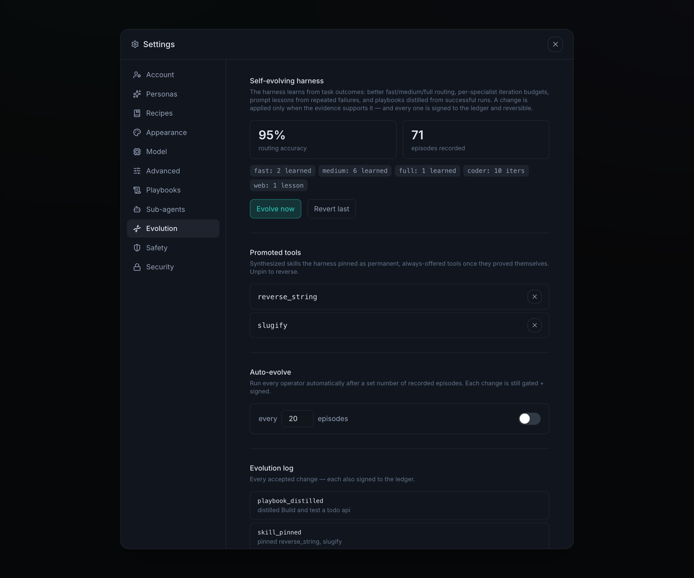

<div align="center">

# Athena

**A self-improving multi-agent swarm that proves its work.**

Every reasoning step, tool call, and self-modification is signed onto a tamper-evident,
hash-chained ledger — so you can *verify* what your agents did, not just read a trace.

[](https://github.com/athena-swarm/athena/actions/workflows/ci.yml)


[](LICENSE)



</div>

---

## What is Athena?

Athena turns a goal into a **swarm**: a router plans a team of specialists, they work in
parallel across a dependency graph, a reflector verifies the result, and a lead
synthesizes the answer. When no tool exists for the job, Athena **writes one**,
sandbox-tests it, and uses it in the same run.

It runs fully **local-first** on Ollama, or against 30+ hosted providers.

```bash
git clone https://github.com/athena-swarm/athena && cd athena
./install.sh                 # venv + native ledger kernel + dashboard
./venv/bin/athena up         # → http://127.0.0.1:8000
```

```bash
athena run "research the top vector databases and write a comparison"
```

---

## What makes Athena different

Most agent frameworks give you orchestration and *observability*. Athena adds two things
they structurally don't have — **provable provenance** and **genuine self-extension** —
and makes both safe by construction.

### 1. It proves its work — cryptographically

Every action is Ed25519-signed by the agent that took it and appended to a hash-chained
ledger. Tamper with any block and the chain breaks. `athena verify` checks it in one
command. This is *provenance*, not logging: tracing tells you what a system claims it
did; a signed chain lets you prove it.

### 2. It builds its own tools, at runtime

When no skill or tool fits, an agent emits `create_skill`. Athena synthesizes the code,
runs a **static capability check**, executes its auto-generated tests **in the sandbox**,
and — only if they pass — injects it into the live run. Proven skills get promoted to
permanent, always-offered tools. Skills that fail get **self-healed**: the harness
repairs the code, re-tests, and retries.

### 3. It improves itself — and provably can't get worse

The self-evolving harness tunes its **own** configuration from outcomes: tier routing,
per-specialist iteration budgets, prompt lessons from recurring failures, distilled
playbooks, its tool library, and retiring dead-weight specialists. Every mutation is

- **gated** — applied only when the evidence supports it (routing changes must raise
  replay accuracy on recorded episodes),
- **signed** — written to the ledger as `EVOLVE_HARNESS`, and
- **reversible** — one-click revert.

<div align="center">
  
</div>

Above: the harness has lifted its own routing accuracy to 95% over 71 episodes, promoted
two synthesized skills (`reverse_string`, `slugify`) to permanent tools, and logged every
change — each one signed and revertible.

### 4. It doesn't pay the full stack tax on every question

An embedding tier-router (sub-millisecond, no model call) sends trivial asks to a
one-shot responder, single-focus work to one capable agent, and only multi-phase goals
to the full planned swarm — and it *learns* from mis-tiered runs. An opt-in semantic
answer cache returns a near-identical prior answer with zero LLM calls.

### 5. Capability-zero sandbox

Synthesized code runs in a WebAssembly guest with **no ambient authority** — it cannot
syscall by default. File access is a separate, opt-in **jailed workspace** with per-file
and total size caps. Athena enforces this itself rather than delegating it to you.

| | Athena | Typical agent framework |
|---|---|---|
| Audit trail | Signed, hash-chained ledger | Tracing / logs |
| New tools | Synthesized + sandbox-tested at runtime | Pre-registered by you |
| Self-improvement | Gated, signed, reversible | Manual tuning |
| Cost control | Learned tiering + semantic cache | Usually one model per call |
| Isolation | WASM, zero ambient authority | Often "enforce at the tool level" |

---

## Features

- **Swarm** — router → parallel specialists (dependency-graph scheduled) → reflector → synthesis
- **Ledger** — Ed25519 identities per agent, hash-chained blocks, one-command verification
- **Skills** — runtime synthesis, capability checks, WASM sandbox, self-healing, promotion
- **Playbooks** — authored markdown procedures the swarm consults on demand
- **Sub-agents** — define your own specialists; the router dispatches to them
- **Workspace** — jailed file tools (`write/read/list/mkdir/delete/edit_file/glob/grep`)
- **Memory** — semantic, episodic, and procedural layers
- **MCP** — connect external tool servers; browser/computer control
- **Context management** — budget-bounded history compaction, ledger-signed
- **Interfaces** — web dashboard, full-parity CLI, desktop app, messaging gateways

## The CLI

```bash
athena up | down | restart | status          # run the server
athena run "…" | chat                        # drive the swarm (streams live)
athena verify | metrics | eval               # trust + performance
athena skills [synth|approve|reject]         # the skill lifecycle
athena evolution [status|evolve|revert]      # the self-evolving harness
athena workspace|playbooks|subagents|cache   # capabilities
athena safety [live|dry-run|halted]          # the kill switch
```

`athena --help` lists everything.

## Configuration

Athena runs offline out of the box. To use a hosted model:

```bash
athena models --set anthropic          # or ollama:qwen2.5:7b-instruct, openai, …
```

Useful environment variables:

| Variable | Purpose |
|---|---|
| `ATHENA_HOME` | State directory (default `~/.athena`) |
| `ATHENA_WORKSPACE` | Enable the jailed file workspace |
| `ATHENA_PLAYBOOKS` | Expose authored playbooks to the swarm |
| `ATHENA_ANSWER_CACHE` | Enable the semantic answer cache (opt-in) |
| `ATHENA_CONTEXT_MAX_CHARS` | History budget for long runs |

## Development

```bash
./install.sh
venv/bin/python -m pytest -q     # 457 tests
npm --prefix frontend run build  # dashboard
```

Architecture notes live in [ARCHITECTURE.md](ARCHITECTURE.md).

## Requirements

- Python 3.10+
- A Rust toolchain (the ledger kernel is a native crate, built by `install.sh`)
- Node.js (to build the dashboard)
- Optional: [AthenaDB](https://github.com/athena-swarm/athenadb) as a sibling repo for the memory layers

## Contributing

Issues and pull requests are welcome — see [CONTRIBUTING.md](CONTRIBUTING.md).
To report a vulnerability, see [SECURITY.md](SECURITY.md).

## License

[Apache License 2.0](LICENSE) — permissive, with an explicit patent grant.
