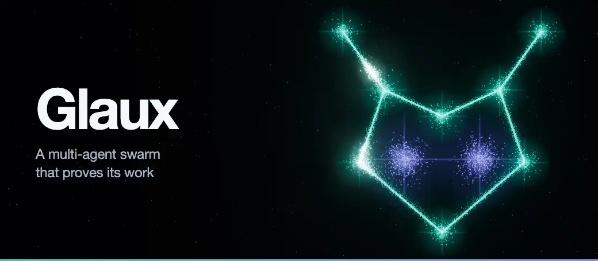
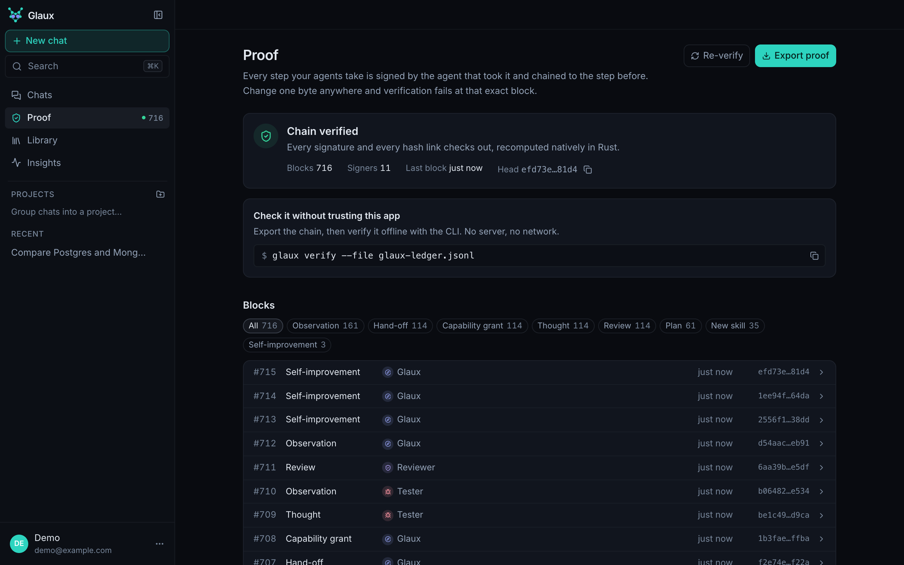
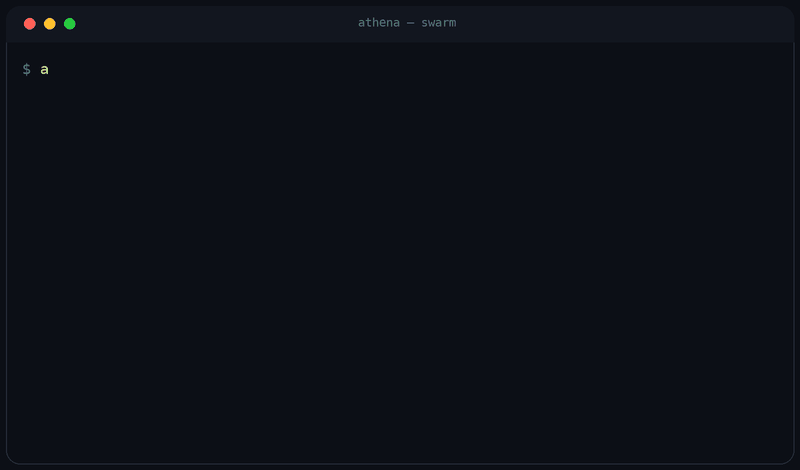
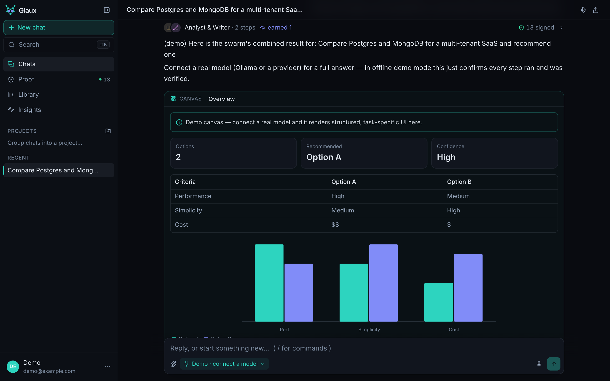
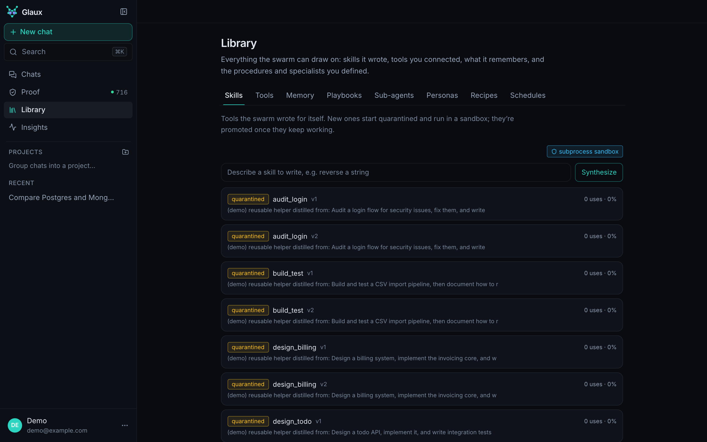
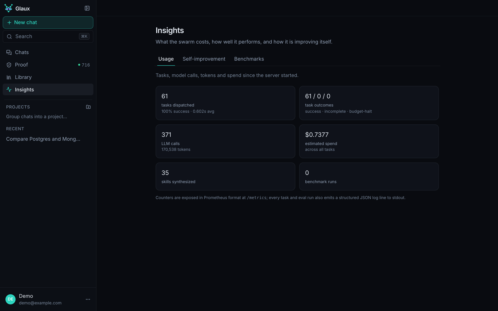
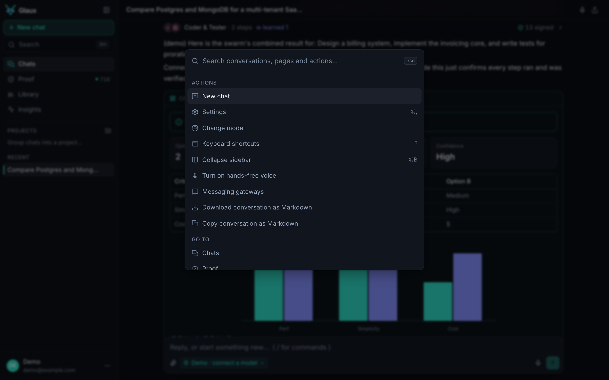

<div align="center">



Every reasoning step, tool call, and self-modification is signed onto a tamper-evident,
hash-chained ledger — so you can *verify* what your agents did, not just read a trace.

[](https://github.com/aniketshukla1/glaux/actions/workflows/ci.yml)


[](LICENSE)

`multi-agent swarm` · `signed ledger` · `runtime tool synthesis` · `self-improving` · `WASM sandbox` · `local-first`

**[aniketshukla1.github.io/glaux](https://aniketshukla1.github.io/glaux/)** · [Documentation](https://aniketshukla1.github.io/glaux/docs/)

</div>

---

## What is Glaux?

Glaux turns a goal into a **swarm**: a router plans a team of specialists, they work in
parallel across a dependency graph, a reflector verifies the result, and a lead
synthesizes the answer. When no tool exists for the job, Glaux **writes one**,
sandbox-tests it, and uses it in the same run. It runs fully **local-first** on Ollama,
or against 30+ hosted providers.

```bash
git clone https://github.com/aniketshukla1/athenadb        # the vector store, cloned alongside
git clone https://github.com/aniketshukla1/glaux && cd glaux
./install.sh                 # venv + native kernels + dashboard
./venv/bin/glaux up         # → http://127.0.0.1:8000
```

<div align="center">

<br />
<sub>Screenshots are from the built-in demo mode: no model connected, answers simulated, signatures real.</sub>
</div>

---

## How a run works

<div align="center">

</div>

---

## What makes Glaux different

| | Glaux | Typical agent framework |
|---|---|---|
| Audit trail | Signed, hash-chained ledger | Tracing / logs |
| New tools | Synthesized + sandbox-tested at runtime | Pre-registered by you |
| Self-improvement | Gated, signed, reversible | Manual tuning |
| Cost control | Learned tiering + semantic cache | Usually one model per call |
| Isolation | WASM, zero ambient authority | Often "enforce at the tool level" |

### 1. It proves its work — cryptographically

Every action is Ed25519-signed by the agent that took it and appended to a hash-chained
ledger. Tracing tells you what a system *claims* it did; a signed chain lets you prove it.
The console's **Proof** page shows the chain: every block, who signed it, and the command
to check it offline.

<div align="center">

</div>

**Don't take our word for it — break it yourself.** Re-attribute one action to a different
agent and the chain names the exact block you touched:

```bash
glaux verify --file ~/.glaux/ledger.jsonl
#  ✓ chain verified   ·   14 signed blocks

# claim someone else took the second action
sed -i.bak '2s/"agent_id":"[^"]*"/"agent_id":"mallory"/' ~/.glaux/ledger.jsonl

glaux verify --file ~/.glaux/ledger.jsonl
#  ✗ CHAIN INVALID at block 1 — block hash mismatch
```

<div align="center">

</div>

`verify --file` reads the chain straight off disk — no running server, and no trust in the
app that wrote it. It exits `0`/`1`, so it drops into CI. Re-signing the forged block
doesn't help: signatures are checked against the acting agent's key, and every later block
hashes the one before it.

To be precise about the guarantee: this proves **integrity and attribution**, not **truth**.
A wrong answer stays wrong — it just becomes non-repudiable, and it can't be quietly edited
afterwards by anyone, including us.

### 2. It builds its own tools, at runtime

When nothing fits, an agent emits `create_skill`. Glaux synthesizes the code, runs a
**static capability check**, executes its generated tests **in the sandbox**, and — only if
they pass — injects it into the live run. Proven skills get promoted to permanent tools;
failing ones get **self-healed**, re-tested, and retried.

### 3. It improves itself, and can't ship a regression

The harness tunes its **own** configuration from outcomes: tier routing, per-specialist
iteration budgets, prompt lessons from recurring failures, distilled playbooks, its tool
library, and retiring dead-weight specialists. Every mutation is **gated** on measured
replay accuracy over recorded episodes, **signed** to the ledger as `EVOLVE_HARNESS`, and
**reversible** in one command. If a change doesn't beat the recorded baseline, it doesn't
ship.

<div align="center">

<br />
<sub>Insights → Self-improvement after 61 tasks on the demo model: routing accuracy up from 31% to 51%, with each change signed.</sub>
</div>

### 4. It doesn't pay the full stack tax on every question

An embedding tier-router (sub-millisecond, no model call) sends trivial asks to a one-shot
responder, single-focus work to one agent, and only multi-phase goals to the full swarm —
and it *learns* from mis-tiered runs. An opt-in semantic cache returns a near-identical
prior answer with zero LLM calls.

### 5. Capability-zero sandbox

Synthesized code runs in a WebAssembly guest with **no ambient authority** — it cannot
syscall by default. File access is a separate, opt-in **jailed workspace** with per-file and
total size caps. Glaux enforces this itself rather than delegating it to you.

---

## The console

<table>
<tr>
<td width="50%" valign="top"><br /><strong>Every answer shows its proof.</strong> Who worked on it, and how many steps were signed.</td>
<td width="50%" valign="top"><br /><strong>Everything it can draw on.</strong> New skills start quarantined and earn promotion.</td>
</tr>
<tr>
<td valign="top"><br /><strong>What it costs.</strong> Tasks, model calls, tokens and spend, plus Prometheus metrics.</td>
<td valign="top"><br /><strong>Keyboard first.</strong> <kbd>⌘K</kbd> reaches every action and page.</td>
</tr>
</table>

---

## The CLI

```bash
glaux up | down | restart | status          # run the server
glaux run "…" | chat                        # drive the swarm (streams live)
glaux verify | metrics | eval               # trust + performance
glaux skills [synth|approve|reject]         # the skill lifecycle
glaux evolution [status|evolve|revert]      # the self-evolving harness
glaux workspace|playbooks|subagents|cache   # capabilities
glaux safety [live|dry-run|halted]          # the kill switch
```

Everything in the dashboard is in the CLI. `glaux --help` lists it all.

Also included: **playbooks** (authored procedures the swarm consults), **sub-agents** (define
your own specialists), a **jailed workspace**, semantic/episodic/procedural **memory**, **MCP**
tool servers, browser and computer control, and a desktop app and messaging gateways.

## Documentation

[Getting started](https://aniketshukla1.github.io/glaux/docs/getting-started/) ·
[Architecture](https://aniketshukla1.github.io/glaux/docs/architecture/) ·
[Self-evolving harness](https://aniketshukla1.github.io/glaux/docs/self-evolution/) ·
[CLI](https://aniketshukla1.github.io/glaux/docs/cli/) ·
[HTTP API](https://aniketshukla1.github.io/glaux/docs/api/) ·
[Configuration](https://aniketshukla1.github.io/glaux/docs/configuration/) ·
[Security model](https://aniketshukla1.github.io/glaux/docs/security/)

## Development

```bash
./install.sh
venv/bin/python -m pytest -q          # 469 tests
scripts/clean_install_test.sh         # install on a pristine container, end to end
```

**Requires** Python 3.10+, a Rust toolchain (the ledger kernel and vector store are native
crates), and [AthenaDB](https://github.com/aniketshukla1/athenadb) cloned as a sibling
directory — the memory layers and skill library are built on it. **Node.js 18+** is needed
only for the dashboard; Ubuntu's default `nodejs` package is older than that, and the API
and CLI work fine without it.

## Contributing

Issues and pull requests are welcome — see [CONTRIBUTING.md](CONTRIBUTING.md).
To report a vulnerability, see [SECURITY.md](SECURITY.md).

## License

[Apache License 2.0](LICENSE) — permissive, with an explicit patent grant.
